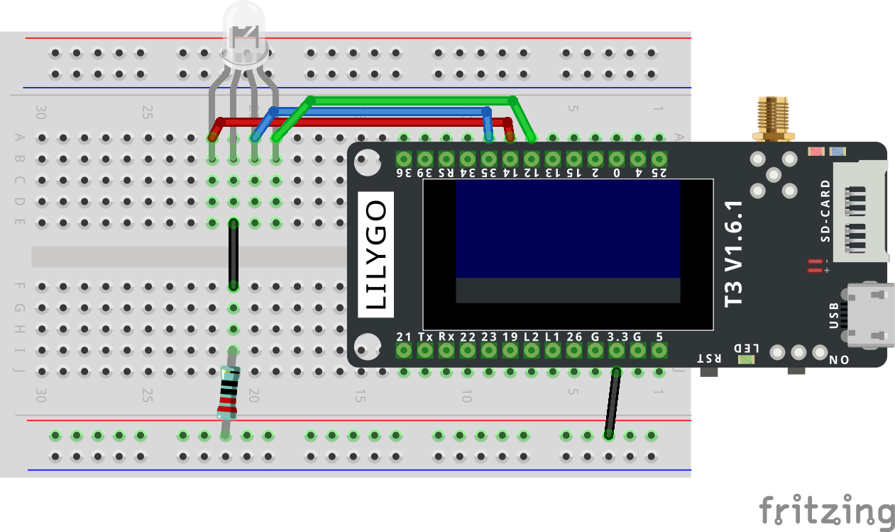
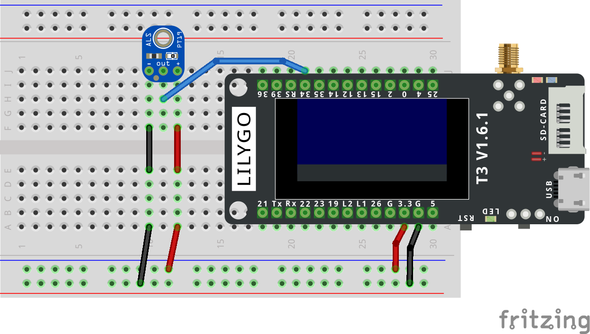

# loraLux

## Funktionsweise
Der loraSender liest die Helligkeit aus und sendet diese and den loraReceiver. Der loraReceiver stellt die
gemessene Helligkeit an einer Mehrfarbigen LED dar. Blau ist der dunkelste Wert und rot der Hellste.
Alle Werte dazwischen werden als Mischwerte von blau und rot abgebildet.
## Material

- Zwei LilyGo T3 1.6.1
- Helligkeitssensor
- Mehrfarbige LED
- 220 Ohm Wiederstand
- Breadboards und Jumperkabel

## Aufbau

### loraReceiver




### loraSender



## Code

### loraReceiver

```C++
#include <SPI.h>
#include "SSD1306Wire.h"
#include <LoRa.h>
#include <string.h>

SSD1306Wire display(0x3c, SDA, SCL);

#define CODE_Buchstabe "B"

#define CS_PIN 18
#define RST_PIN 23
#define DIO_PIN 26

#define RedPIN   12
#define GreenPIN 13
#define BluePIN  14

int counter = 1;
float rawValue = 0;

const int pwmFreq = 5000;
const int pwmResolution = 12;  // 12 Bit → 0 bis 4095

int minSensor = 0;
int maxSensor = 4095;

void setup() {
  Serial.begin(115200);

  display.init();
  display.flipScreenVertically();
  display.setFont(ArialMT_Plain_10);
  display.setTextAlignment(TEXT_ALIGN_LEFT);
  display.displayOn();
  display.clear();
  display.println("LoRa Receiver");
  display.display();

  ledcAttach(RedPIN, pwmFreq, pwmResolution);
  ledcAttach(GreenPIN, pwmFreq, pwmResolution);
  ledcAttach(BluePIN, pwmFreq, pwmResolution);

  ledcWrite(RedPIN, 0);
  ledcWrite(GreenPIN, 4095);
  ledcWrite(BluePIN, 4095);   

  LoRa.setPins(CS_PIN, RST_PIN, DIO_PIN);
  if (!LoRa.begin(868000000)) {
    display.println("Starting LoRa failed!");
    display.display();
    while (1);
  }

  display.println("LoRa ok");
  display.display();
  delay(1000);
}

void loop() {
  int packetSize = LoRa.parsePacket();

  if (packetSize == 5) {
    uint8_t payload[5];
    int len = LoRa.readBytes(payload, sizeof(payload));

    if (len == 5 && payload[0] == CODE_Buchstabe[0]) {
      memcpy(&rawValue, &payload[1], sizeof(rawValue));

      int redValue = rawValue;            
      int greenValue = 4095;              
      int blueValue = 4095 - rawValue;    

      // instead of digitalWrite we use ledcWrite
      // this enables the use of brightness where digitalWrite can only set on and off
      ledcWrite(RedPIN, redValue);
      ledcWrite(GreenPIN, greenValue);
      ledcWrite(BluePIN, blueValue);

      Serial.println("------------------------");
      Serial.println("RSSI: " + String(LoRa.packetRssi()));
      Serial.println("Empfangen: " + String(rawValue));
      Serial.println("Rot: " + String(redValue) + " | Blau: " + String(blueValue));
      Serial.println("Counter: " + String(counter));

      display.clear();
      display.println("LoRa Receiver");
      display.println("");
      display.println("Counter: " + String(counter));
      display.println("ADC: " + String((int)rawValue));
      display.println("RSSI: " + String(LoRa.packetRssi()));
      display.println("");
      display.display();

      counter++;
    }
  }
}
```

### loraSender


```C++
#include <SPI.h>
#include <SSD1306Wire.h>
#include <LoRa.h>
#include <string.h>

SSD1306Wire display(0x3c, SDA, SCL);

// -----  Hier anpassen  ------------------------------
#define CODE_Buchstabe "B"
// ----------------------------------------------------

#define breite display.getWidth()
#define CS_PIN  18
#define RST_PIN 23
#define DIO_PIN 26
#define ADC_PIN 34
#define Messintervall 1000

float rawValue = 0;
int counter = 1;

void setup() {
  Serial.begin(115200);

  display.init();
  display.flipScreenVertically();
  display.setFont(ArialMT_Plain_10);
  display.setTextAlignment(TEXT_ALIGN_LEFT);
  display.displayOn();
  display.clear();
  display.println("LoRa Sender");
  display.display();

  LoRa.setPins(CS_PIN, RST_PIN, DIO_PIN);
  if (!LoRa.begin(868000000)) {
    display.println("Starting LoRa failed!");
    display.display();
    while (1);
  }

  display.println("LoRa ok");
  display.display();
  delay(1000);
}

void loop() {
  rawValue = analogRead(ADC_PIN);

// Payload wird nicht als direkter Zahlenwert versendet, sondern ein Array an Bytes. 
// Im Receiver kann diese Payload korrekt in einen Zahlenwert umgewandelt werden.
// Im Gegensatz zur Alternative mit den Strings. 

  uint8_t payload[5];
  payload[0] = CODE_Buchstabe[0];
  memcpy(&payload[1], &rawValue, sizeof(rawValue));

  LoRa.beginPacket();
  LoRa.write(payload, sizeof(payload));
  LoRa.endPacket();

  Serial.print("Gesendet: ");
  Serial.println(rawValue);

  display.clear();
  display.println("LoRa Sender");
  display.println("");
  display.println("Sending packet:");
  display.println(String(counter));
  display.println("ADC:");
  display.println(String(rawValue, 2));
  display.display();

  counter++;
  delay(1000);
}
``` 
